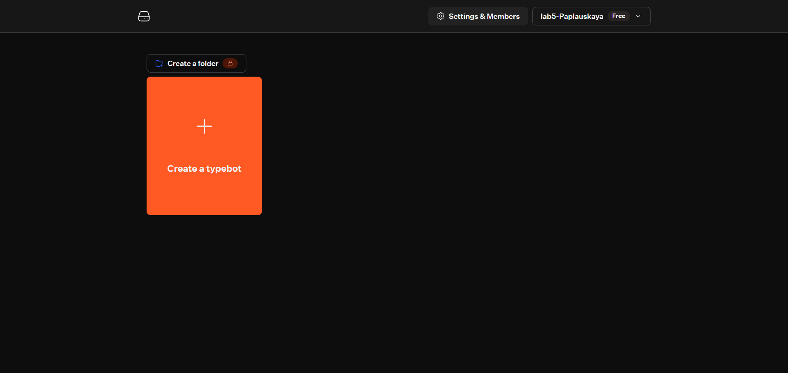
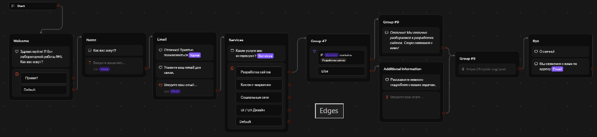
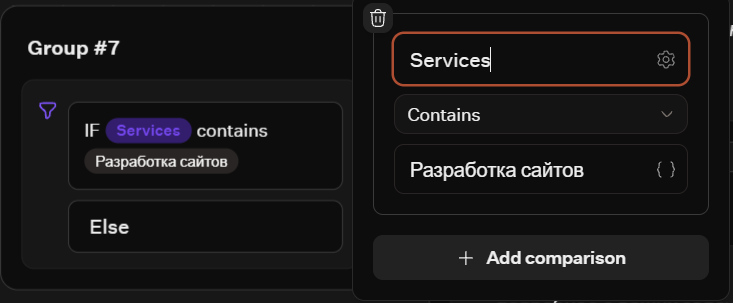
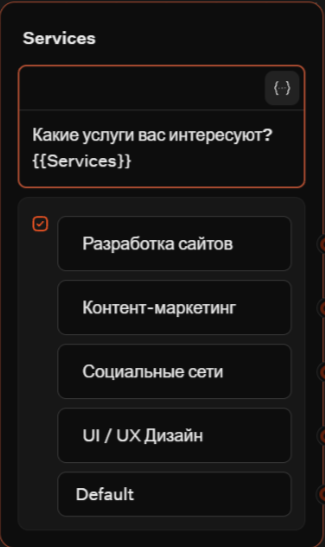
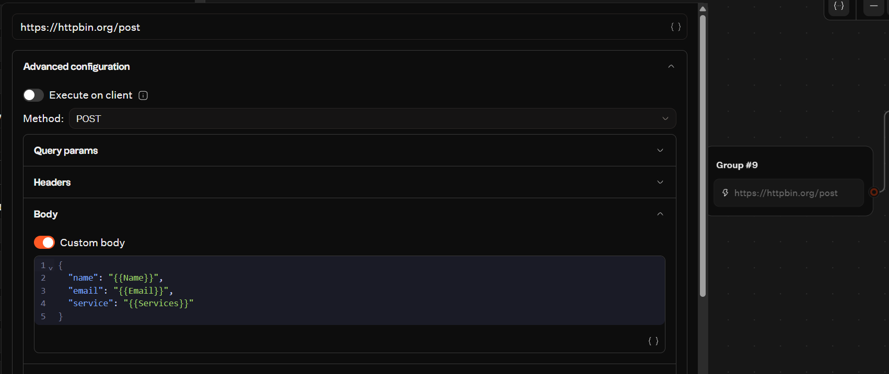
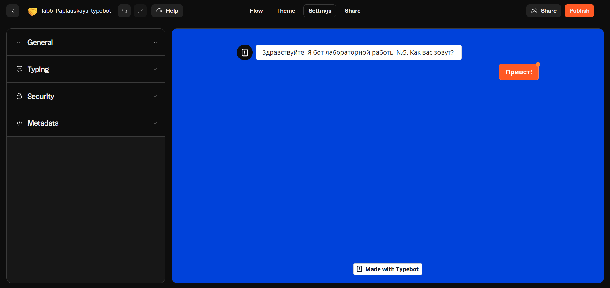
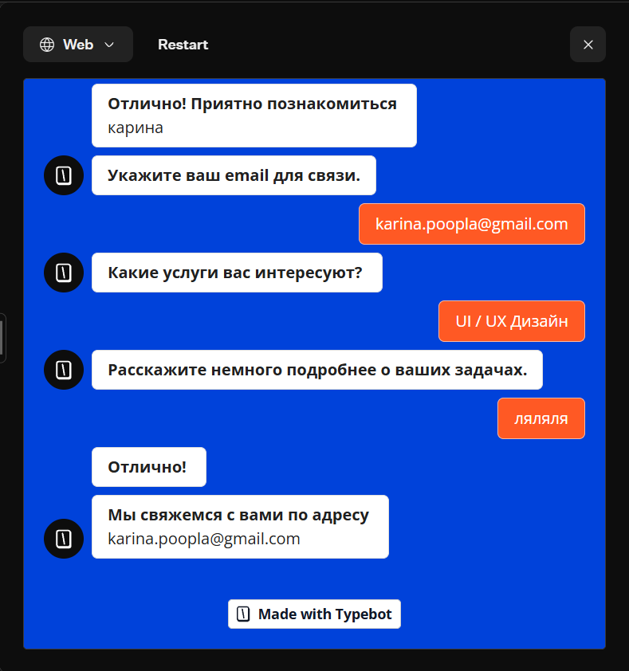

# Лабораторная работа №5 — Чат-боты

**Студент:** Поплавская Карина
**Трек:** C — TypeBot

## 1. Краткое описание выбранного трека
В рамках лабораторной работы был выбран трек **TypeBot** (low-code/no-code платформа для создания чат-ботов). За основу был взят готовый шаблон из галереи Templates, который впоследствии был полностью русифицирован и значительно доработан. В процессе работы были освоены базовые блоки, настройка переменных, ветвление логики (Condition) и отправка данных во внешние сервисы (HTTP Request).

**Ссылка на бота:** https://typebot.io/lab5-paplauskaya-typebot-xxxx *(вставьте вашу реальную ссылку после публикации)*

## 2. Использованные AI-промпты (3–5 примеров)
1. «Переведи тексты шаблона чат-бота Lead Generation на русский, сохранив имена переменных (Name, Email, Phone) без изменений.»
2. «Как в TypeBot настроить Condition, чтобы проверять, содержит ли переменная Services слово "Разработка сайтов"?»
3. «Какой публичный API подходит для тестирования Webhook / HTTP Request в TypeBot без регистрации?»
4. «Объясни разницу между блоками Set variable и Input в TypeBot.»
5. «Какие ограничения у бесплатного тарифа TypeBot Cloud?»

## 3. Освоенные блоки/ноды
В ходе выполнения работы были использованы следующие блоки:
*   **Text (Текст)** — для вывода приветствия, вопросов и прощания.
*   **Input (Ввод)** — для сбора имени (`Name`) и email (`Email`), а также настройки плейсхолдеров (подсказок в поле ввода).
*   **Choice (Кнопки)** — для выбора услуг. Ответ сохраняется в переменную `Services`.
*   **Condition (Условие)** — для ветвления диалога. Если переменная `Services` содержит «Разработка сайтов», бот выдает один ответ, иначе (Else) — другой.
*   **HTTP Request (Интеграция)** — для отправки POST-запроса с данными пользователя на тестовый сервер `httpbin.org`.
*   **Theme / Branding** — для изменения цветовой схемы и брендинга бота.

## 4. Скриншоты

## 5. Описание изменений (относительно базового шаблона)
В рамках работы над шаблоном были внесены следующие изменения:
1.  **Русификация:** переведены все тексты, кнопки, описания, сообщения об ошибках и плейсхолдеры.
2.  **Новые блоки:** добавлены дополнительные шаги (сбор имени и email).
3.  **Переменные:** добавлена переменная `Services` для хранения выбора пользователя.
4.  **Условия:** добавлен блок Condition, который проверяет выбор пользователя.
5.  **Интеграция:** добавлен HTTP Request (отправка данных `Name`, `Email`, `Services` на внешний сервер).
6.  **Брендинг:** сменена тема оформления и название бота.

## 6. Выводы
В ходе работы я научилась создавать и адаптировать чат-бота на платформе TypeBot. Я поняла, как работают переменные (они нужны для хранения ответов пользователя и передачи их в другие блоки), как настраивать логику с помощью Condition, а также как интегрировать бота с внешними сервисами через HTTP Request. 

Также я изучила ограничения бесплатного тарифа TypeBot Cloud: доступно 200 чатов в месяц, 1 участник команды, и нельзя убрать брендинг TypeBot. Для реальных проектов с большим трафиком потребуется платный тариф или развертывание open-source версии (self-hosted) через Docker.