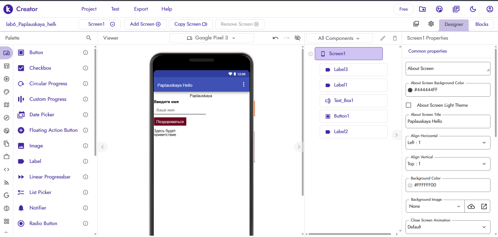
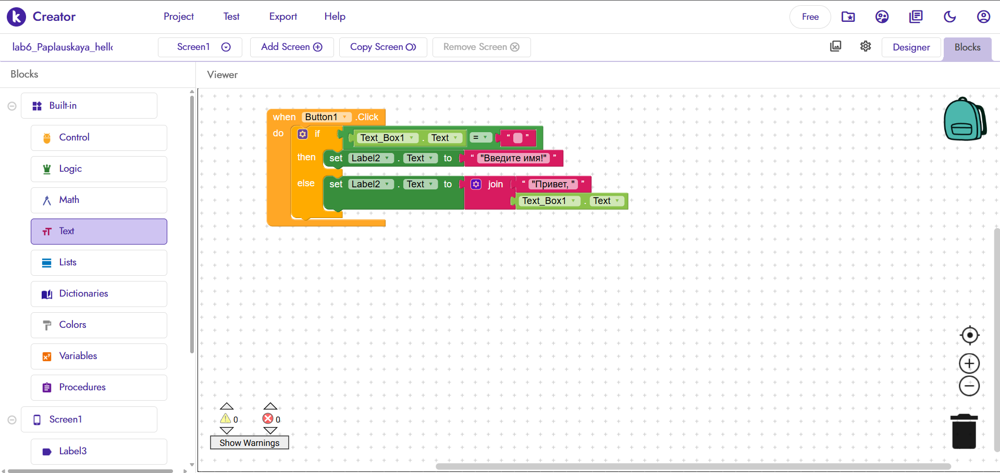
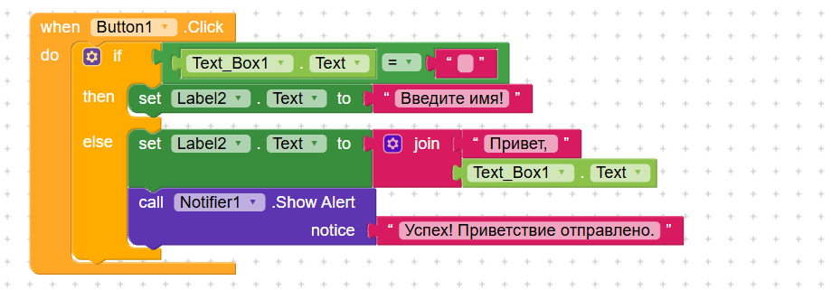

# Лабораторная работа №6. Kodular

**Студент:** Paplauskaya
**Группа:** [Твоя группа]

## 1. Базовое приложение
Реализовано приложение «Приветствие». 
На экране Screen1 размещены: Label (заголовок), TextBox (для ввода имени), Button (кнопка «Поздороваться»), Label (для вывода результата) и Label с фамилией студента (Paplauskaya).
**Логика:** При нажатии на кнопку проверяется, пустое ли поле TextBox. Если пустое — выводится «Введите имя!». Если нет — выводится «Привет, <имя>!» с использованием блока join.

## 2. Реализованные ачивки
**Ачивка 1: Notifier (Уведомления)**
При успешном приветствии (когда имя введено) срабатывает всплывающее уведомление с текстом «Успех! Приветствие отправлено.».
*Использованные компоненты:* Notifier.
*Блоки:* `call Notifier1.ShowAlert` внутри ветки else.

## 3. Ссылка на проект / файл
Экспортированный файл: `exports/lab6-Paplauskaya.aia`.

## 4. Скриншоты

## 5. AI-промпты
1. «Как в Kodular сделать так, чтобы при нажатии на кнопку проверялось, пустое ли текстовое поле, и выводилось сообщение?»
2. «Как реализовать всплывающее уведомление в Kodular после успешного действия?»
3. «Как собрать блоки join и if/else для проверки пустого поля?»

## 6. Освоенные компоненты и блоки
**Компоненты:** Label, TextBox, Button, Notifier.
**Блоки:** `when Button1.Click`, `if / then / else`, `=`, `set Label2.Text`, `join`, `call Notifier1.ShowAlert`.

## 7. Ограничения бесплатного тарифа
В бесплатном тарифе Kodular действуют ограничения: до 10 проектов, до 10 МБ ассетов, до 5 расширений. При работе с базовым приложением и ачивкой данные лимиты не были превышены.

## 8. Выводы
В ходе лабораторной работы я освоила платформу Kodular для визуального программирования. Научилась работать с компонентами интерфейса и собирать логику из блоков (условия, соединение строк). Также я реализовала дополнительную функцию (уведомления) и научилась экспортировать готовый проект.