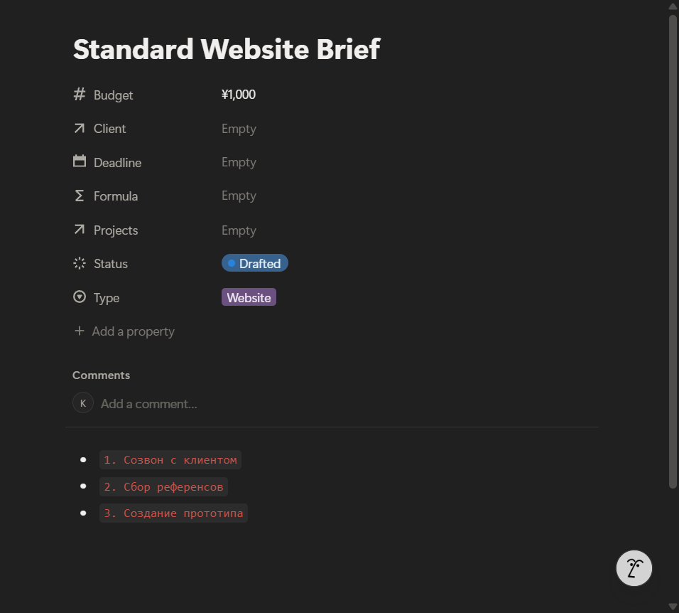
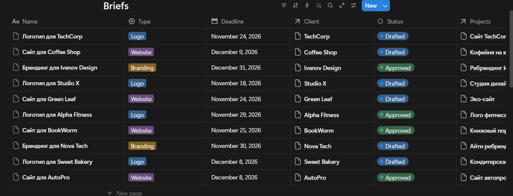
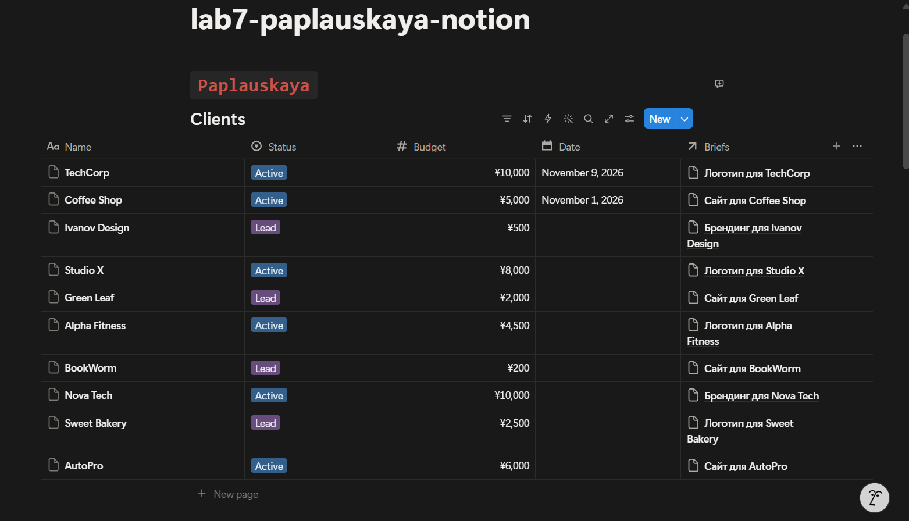
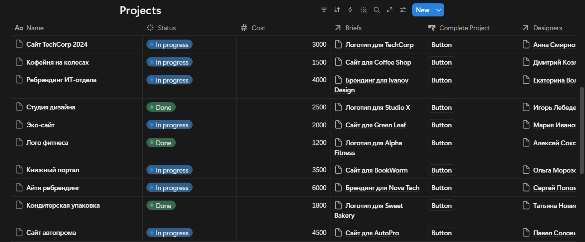
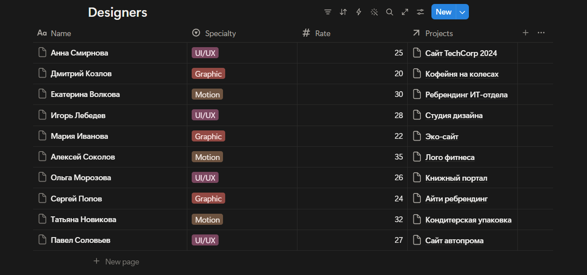
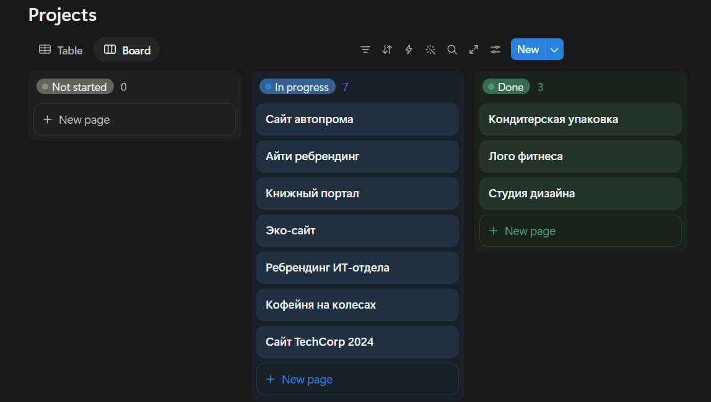
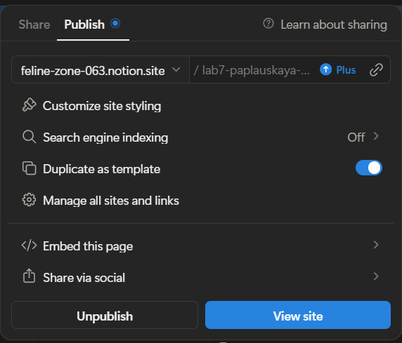

# Лабораторная работа №7. Notion

**Выполнила:** Поплавская Карина

## 1. Предметная область и модель данных

В качестве предметной области выбрана **«Управление дизайн-студией: Клиенты, Брифы, Проекты и Дизайнеры»**. 
Этот трекер позволяет автоматизировать рутинные процессы студии: от первичного общения с клиентом и сбора брифа до контроля дедлайнов и распределения дизайнеров по проектам.

**Сущности (базы данных):**
1. **Clients (Клиенты)** — хранит информацию о заказчиках. Свойства: `Name` (Title), `Status` (Select), `Contact Date` (Date), `Budget` (Number).
2. **Briefs (Брифы)** — технические задания от клиентов. Свойства: `Name` (Title), `Type` (Select), `Deadline` (Date), `Status` (Select), `Client` (Relation), `Budget` (Number), `Days Left` (Formula).
3. **Projects (Проекты)** — рабочие задачи, созданные на основе брифов. Свойства: `Name` (Title), `Status` (Select), `Deadline` (Date), `Cost` (Number), `Brief` (Relation), `Complete Project` (Button).
4. **Designers (Дизайнеры)** — сотрудники студии. Свойства: `Name` (Title), `Specialty` (Select), `Rate` (Number), `Projects` (Relation).

**Связи (Relations):**
1. `Clients` ↔ `Briefs` (Двусторонняя связь: у одного клиента может быть много брифов).
2. `Briefs` ↔ `Projects` (Двусторонняя связь: один бриф может породить один или несколько проектов).
3. `Projects` ↔ `Designers` (Двусторонняя связь: один дизайнер ведет несколько проектов, у проекта может быть несколько исполнителей).

## 2. Промпт для ИИ и ответ

**Промпт:**
> «Придумай уникальную предметную область для учебного проекта в Notion. Тема должна быть связана с дизайном и брифованием клиентов. Нужно 4 связанные сущности. Минимум 2 связи типа Relation. У каждой сущности минимум 3 свойства. Обязательно используй типы: Title, Select, Date, Number, Relation, Formula. Придумай минимум одну формулу и одну кнопку. Опиши модель данных.»

**Ответ ИИ (кратко):**
ИИ предложил 4 сущности (Clients, Briefs, Projects, Designers) и связи между ними. В качестве формулы предложил использовать расчет дней до дедлайна: `dateBetween(prop("Дедлайн сдачи"), now(), "days")`. В качестве кнопки — кнопку изменения статуса проекта на "Done".

**Что я исправила после проверки:**
1. ИИ предложил 4 сущности, но связи между ними были неполными. Я уточнила, что база «Designers» должна быть связана с «Projects» связью Relation.
2. В сущности «Briefs» не хватало свойства с типом Number. Я добавила свойство «Budget брифа» (Number), чтобы можно было считать общую стоимость.
3. ИИ предложил формулу с датами, но не учел, что дедлайн может пройти. При реализации я оставила базовый вариант `dateBetween`, так как он корректно отображает просрочку минусовыми днями.

## 3. Реализованные дополнительные возможности (Ачивки)

**Ачивка 2: Шаблоны записей (Templates)**
- **Настройки:** В базе `Briefs` создан шаблон «Standard Website Brief». В нём предзаполнены свойства `Type` = Website, `Status` = Draft, `Budget` = 1000. Также в тело записи добавлен чек-лист этапов работы. При создании новой записи через `New` -> `Standard Website Brief` все поля подставляются автоматически.

## 4. Ссылка на опубликованную страницу Notion

Проект опубликован в веб и доступен по ссылке:
🔗 **[https://feline-zone-063.notion.site/lab7-paplauskaya-notion-40a32bd7814880a39259c12a8ed4de6e](https://feline-zone-063.notion.site/lab7-paplauskaya-notion-40a32bd7814880a39259c12a8ed4de6e)**

## 5. Все скриншоты баз данных и настроек

**База данных Briefs (с формулой Days Left):**

**База данных Clients:**

**База данных Projects (с кнопкой Complete):**

**База данных Designers:**

**Представление Board (Kanban):**

**Настройки публикации (Publish):**

## 6. Ключевые AI-промпты
1. *Придумай уникальную предметную область для учебного проекта в Notion...* (генерация модели данных).
2. *Как в Notion настроить двустороннюю связь Relation между базами?* (помощь с интерфейсом).
3. *Какую формулу использовать для вычисления дней до дедлайна в Notion?* (помощь с синтаксисом Formula).
4. *Как создать шаблон записи для базы данных в Notion?* (помощь с ачивкой).

## 7. Освоенные компоненты и настройки Notion
В ходе работы были освоены следующие элементы:
- Создание страниц и рабочих пространств (Workspace).
- Создание баз данных (Database - Inline).
- Настройка свойств: Title, Select, Date, Number, Relation, Formula, Button.
- Настройка двусторонних связей (Two-way relation).
- Написание формул для вычисления дат (`dateBetween`).
- Настройка кнопок с действиями (`Edit property`).
- Создание шаблонов записей (Templates).
- Создание пользовательских представлений (Table, Board).
- Публикация страницы в веб (Publish to web).

## 8. Ограничения бесплатного тарифа Notion
При выполнении работы были замечены следующие ограничения бесплатного тарифа:
- Лимит на размер загружаемых файлов (до 5 МБ).
- Ограничение на количество гостей (Guest) — не более 10 человек.
- Нет полной истории версий страницы.
- Нельзя создавать базы данных с правами доступа для отдельных групп.

## 9. Выводы
В ходе выполнения лабораторной работы я научилась использовать Notion как полноценную low-code платформу. Я освоила создание связанных баз данных, настройку сложных типов свойств (Relation, Formula, Button) и публикацию проектов в веб. 

Я поняла, что Notion позволяет создавать гибкие системы управления проектами, которые легко адаптируются под конкретный бизнес (в данном случае — дизайн-студию), а встроенные инструменты автоматизации (кнопки и формулы) значительно упрощают рутину.
